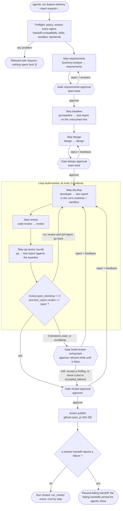
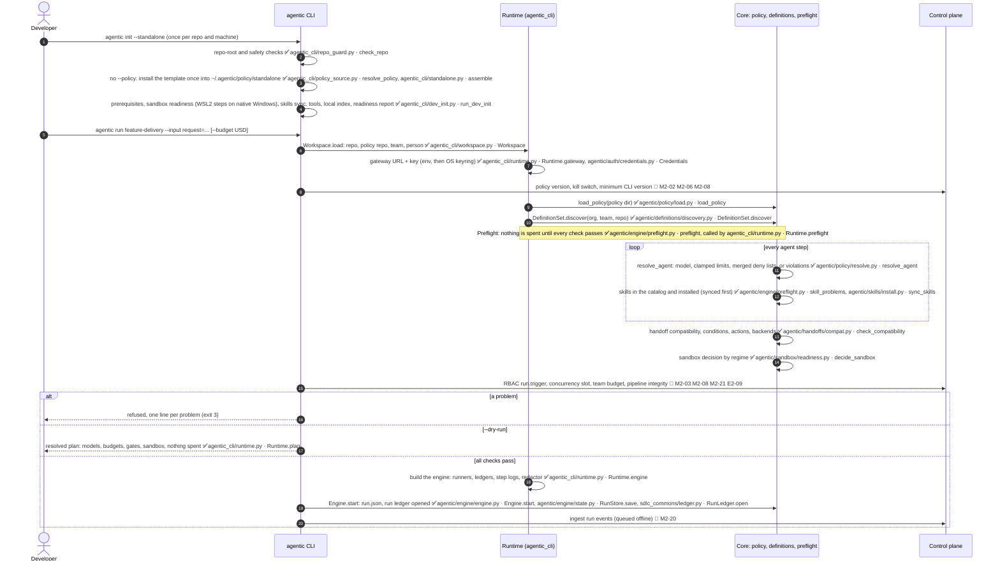
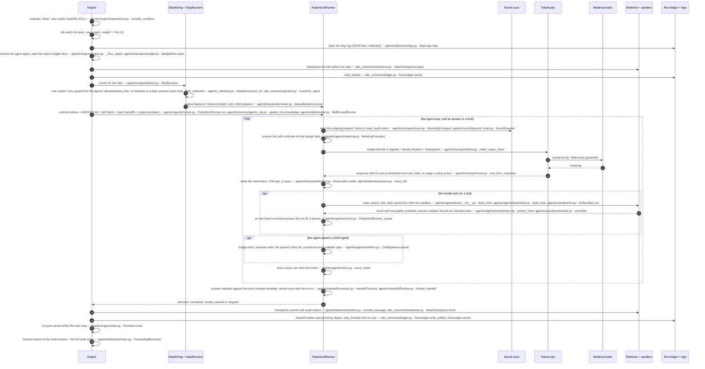
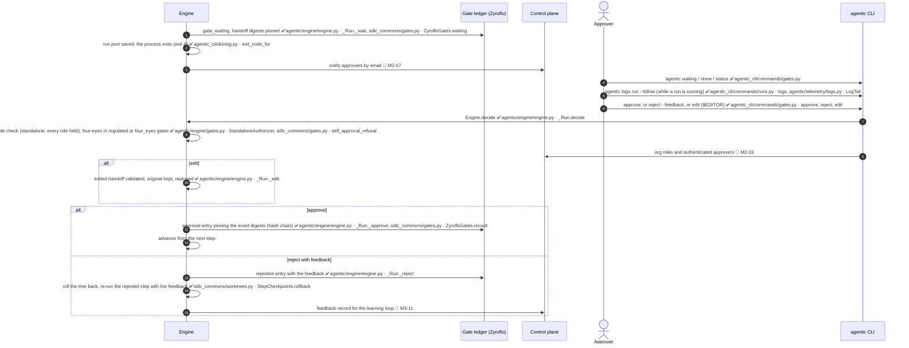
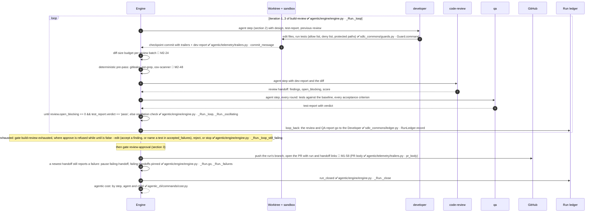

# Call flow — one `feature-delivery` run, start to finish

| | |
|---|---|
| Status | **Updated 2026-10-21** (M1-73) to match the code on `m1-foundation` plus the M1 finishing track. The final check against the running system is at the M1 demo (M1-72). |
| Scenario | **Standalone mode**, which is what M1 delivers (spec §24): one person, a local policy (`agentic init --standalone`), any TokenLean gateway, the library `feature-delivery` pipeline. Org mode adds the control plane: every box marked M2-xx. |
| Legend | ✅ **built**: the code exists and is tested, named as `package/module.py · function`. 🔲 **planned**: the tracker row that builds it. |
| Paths | `agentic/…` is `core/src/agentic/`; `agentic_cli/…` is `cli/src/agentic_cli/`; `sdlc_commons/…` is `commons/src/sdlc_commons/`, the adapters over Zyroflo. The core never imports `sdlc_commons` or Zyroflo; `agentic_cli/runtime.py` and `agentic_cli/wiring.py` join them. |
| Diagrams | Checked with mermaid-cli 11.4.2 in its Linux container: `uv run python scripts/check_diagrams.py docs/architecture/call-flow.md`. |

## 0. The pipeline being run

`library/pipelines/feature-delivery.yaml` runs in the `team` regime: agent commands need the OS sandbox, and every gate needs a person.

## 1. Setup, start and preflight

A request is given as `--input request=...`, or taken from a Jira issue with `agentic run <pipeline> --from-jira PROJ-123` ✅ M2-50 (agentic_cli/jira.py · the `jira:` user settings in docs/user-config.md); the run reports back to the issue as it ends.

## 2. One agent step (the same for every agent step)

What stops a step, and what happens next (✅ `agentic/engine/engine.py · _Run._agent`, `_Run._outcome`):

| Cause | Run state | Next |
|---|---|---|
| Run or step budget reached | paused `budget` / `step-budget` | `agentic resume --extra-budget` (run budget only) |
| Turns, time, stuck agent | paused `step-turns` / `step-time` / `step-stuck` | `agentic resume` |
| Invalid answer after one retry | waiting at gate `invalid-output` | `agentic edit` or `agentic reject` |
| Agent reports it is blocked | waiting at gate `blocked-output` | a person decides |
| A command on the ask list | paused for approval | `agentic resume --allow/--deny` |
| Policy refuses the agent, provider or tool error | paused `policy` / `step-error` | fix, then `agentic resume` |
| Secret found in outgoing content (block) | paused `step-error`, audit event | remove the secret, `agentic resume` |

## 3. A human gate

## 4. Build/review loop, QA, pull request, close

**Running beside the whole run:** structured step logs in `<run>/logs/` and OTel spans in the run folder ✅ `agentic_cli/driving.py · drive, traces_into` · run heartbeat and zombie detection 🔲 M3-07 · kill-switch polling at every step and turn 🔲 M2-19 · budget alerts at 80 % and 100 % 🔲 M2-16 · auto-trip on abnormal team spend or error rate 🔲 M2-11.

## 5. Step table

| # | When | Call | Where | Status |
|---|---|---|---|---|
| 1 | Setup | Standalone policy repo from the template, installed once | `agentic_cli/policy_source.py · resolve_policy`, `agentic_cli/standalone.py · assemble` | ✅ M1-62 |
| 2 | Setup | Readiness: prerequisites, sandbox (WSL2 guidance), skills, tools, index | `agentic_cli/dev_init.py · run_dev_init`, `agentic_cli/readiness.py · prerequisites` | ✅ M1-53 M1-33 |
| 3 | Start | Workspace: repo, policy repo, team, person; gateway credential | `agentic_cli/workspace.py · Workspace`, `agentic_cli/runtime.py · Runtime.gateway` | ✅ M1-54 M1-48 |
| 4 | Start | Org policy and definitions across org / team / repo (D33) | `agentic/policy/load.py · load_policy`, `agentic/definitions/discovery.py · DefinitionSet.discover` | ✅ M1-03 M1-04 |
| 5 | Preflight | Resolve agents, compatibility, conditions, skills, backends, sandbox | `agentic/engine/preflight.py · preflight`, `agentic/policy/resolve.py · resolve_agent`, `agentic/sandbox/readiness.py · decide_sandbox` | ✅ M1-25 |
| 6 | Preflight | RBAC, kill switch, CLI version, concurrency, team budget, pipeline integrity | control plane | 🔲 M2-21 M2-03 M2-08 E2-09 |
| 7 | Start | Run folder, run.json, run ledger | `agentic/engine/engine.py · Engine.start`, `sdlc_commons/ledger.py · RunLedger.open` | ✅ M1-21 M1-06 |
| 8 | Every step | `when`, kill switch | `agentic/engine/expressions.py · compile_condition` | ✅ M1-23 · 🔲 M2-19 |
| 9 | Every step | Worktree checkpoint before and after, commit trailers | `sdlc_commons/worktrees.py · StepCheckpoints`, `agentic/telemetry/trailers.py · commit_message` | ✅ M1-30 M1-45 |
| 10 | Every step | Tool context: guard, sandbox, skills, codeintel | `agentic_cli/wiring.py · StepWiring.tools_for`, `sdlc_commons/guards.py · Guard.for_agent`, `agentic/sandbox/srt.py · SrtSandbox` | ✅ M1-31 M1-32 M1-38 M1-36 |
| 11 | Every step | Agent loop on the native backend: tools, children, stuck check, limits, approval pauses | `agentic/backends/native.py · NativeBackend.runner`, `agentic/agents/runner.py · PydanticAIRunner`, `agentic/agents/children.py · ChildSpawner` | ✅ M1-15…M1-18 M1-28 |
| 12 | Every step | Agent-CLI backend (claude-code): built, not wired into the CLI | `agentic/backends/claude_code.py` | ✅ M1-29 · 🔲 DF-74 |
| 13 | Every model call | Secret scan, identity headers, corporate network, metering and budget, cost capture, span | `agentic/transport/scan.py`, `agentic/transport/client.py · make_async_client`, `agentic/agents/metering.py · MeteringTransport`, `agentic/transport/cost.py · cost_from_response`, `agentic/telemetry/spans.py` | ✅ M1-11…M1-14 M1-41 M1-43 M1-65 |
| 14 | Every tool result | Host paths scrubbed, secrets masked, fenced as untrusted | `agentic/agents/tools/protect.py · protect_tools`, `agentic/security/untrusted.py · untrusted` | ✅ M1-41 M1-42 |
| 15 | Every step end | Answer validated, retried once, handoff pinned, step_finished with cost | `agentic/handoffs/contract.py · HandoffContract`, `agentic/engine/engine.py · _Run._outcome` | ✅ M1-19 M1-20 M1-79 |
| 16 | Every step | Structured step log, redacted; `agentic logs [--follow]` | `agentic/telemetry/logs.py · StepLogs, LogTail`, `agentic_cli/commands/runs.py · logs` | ✅ M1-47 |
| 17 | Every step end | Events to the control plane | `agentic/telemetry/sinks.py · ForwardingRecorder` (no sink yet) | 🔲 M2-20 |
| 18 | Gates | Pause, show, approve / reject / edit, four-eyes, digest-pinned approval | `agentic/engine/engine.py · _Run.decide`, `agentic_cli/commands/gates.py`, `sdlc_commons/gates.py · ZyrofloGates` | ✅ M1-22 M1-55 · 🔲 M2-03 M2-07 |
| 19 | Loop | `until`, max iterations, oscillation, exhausted → gate | `agentic/engine/engine.py · _Run._loop, _Run._oscillating` | ✅ M1-24 |
| 20 | Review | Diff budget, deterministic pre-pass | review / security | 🔲 M2-24 M2-48 |
| 21 | End | Open the PR | GitHub adapter (`agentic/telemetry/trailers.py · pr_body` ready) | 🔲 M1-58 |
| 22 | End | run_closed, cost by step / agent / child | `agentic/engine/engine.py · _Run._close`, `agentic_cli/commands/cost.py` | ✅ M1-57 |
| 23 | Background | Heartbeat, kill-switch polling, budget alerts, auto-trip | control plane + CLI | 🔲 M3-07 M2-19 M2-16 M2-11 |

**Built:** everything a standalone run needs up to the pull request. That covers setup, preflight, the engine with gates and loops, the native backend with tools, children, sandbox, secret scan and skills, code intelligence, telemetry, and the ledgers.

**Not built yet:**
- opening the PR (M1-58), so the library pipelines' `publish` step fails preflight with `unknown action 'github.open_pr'` until it lands;
- wiring the claude-code backend into the CLI (DF-74);
- everything in the control plane (M2).
