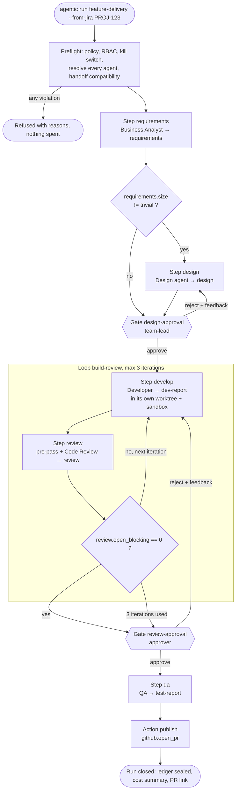
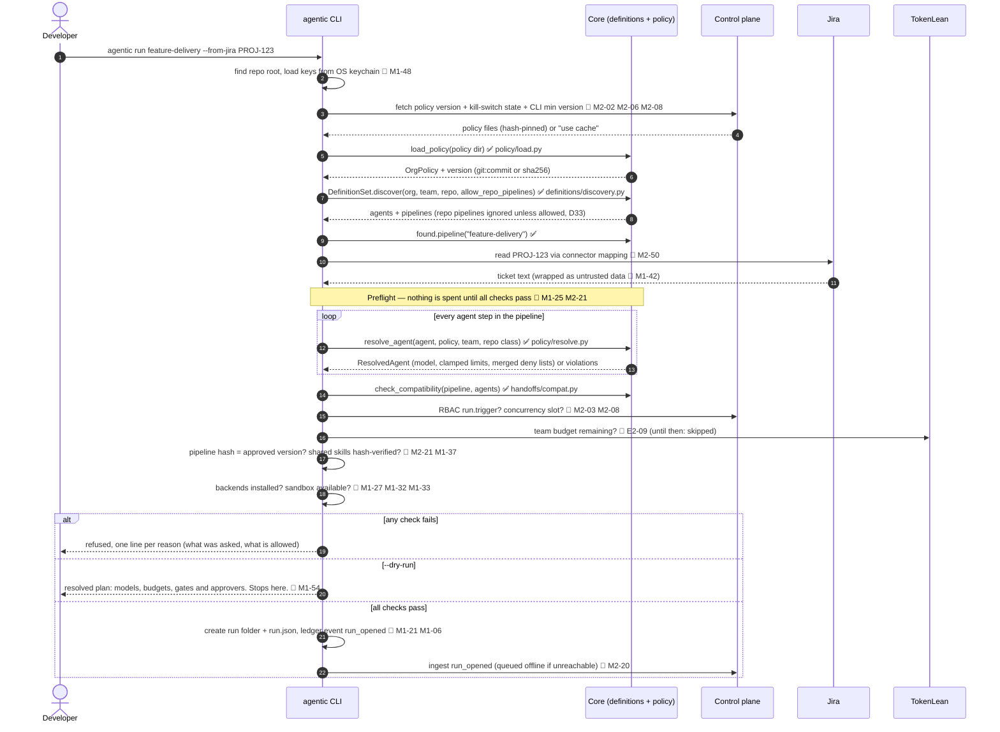
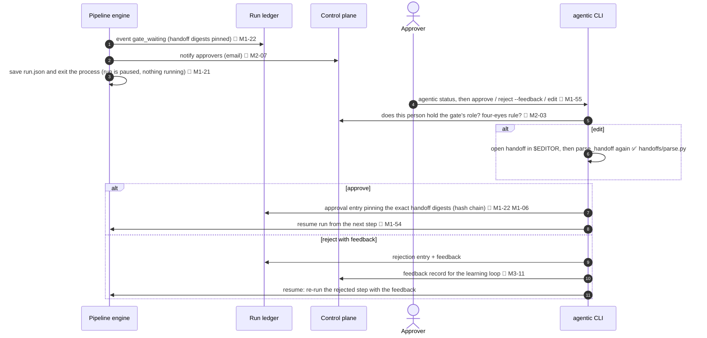
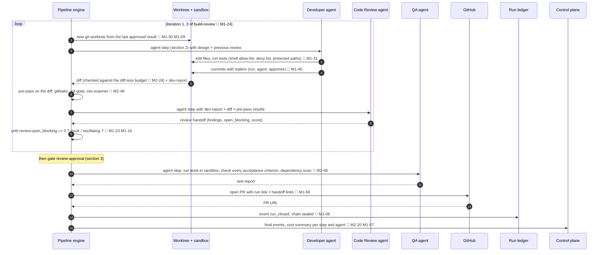

# Call flow — one `feature-delivery` run, start to finish

| | |
|---|---|
| Status | **Draft** (M1-73). Updated as components land; final version checked against the running system at the M1 demo (M1-72). |
| Scenario | Org mode, default `feature-delivery` pipeline, developer starts from a Jira ticket. Standalone mode is the same minus the control plane. |
| Legend | ✅ **built** — file and function exist and are tested · 🔲 **planned** — tracker row that builds it |

## 0. The pipeline being run



## 1. Start and preflight



## 2. One agent step, in detail (same for every agent step)

```mermaid
sequenceDiagram
    autonumber
    participant Eng as Pipeline engine
    participant CP as Control plane
    participant Run as AgentRunner (Pydantic AI)
    participant Sec as Secret scan
    participant TL as TokenLean
    participant LLM as LLM provider
    participant WT as Worktree + sandbox
    participant Led as Run ledger

    Eng->>Eng: evaluate `when` over earlier handoffs 🔲 M1-23
    Eng->>CP: kill switch / pause for this team, user, agent, model? 🔲 M2-19
    Eng->>Led: event step_started 🔲 M1-06 M1-07
    Eng->>Run: run(ResolvedAgent, input handoffs) ✅ agents/runner.py PydanticAIRunner.run
    Run->>Run: build prompt = instructions + pre-loaded skills + AGENTS.md + input handoffs 🔲 M1-38 M1-46
    loop agent loop, until done or a limit is hit
        Run->>Sec: scan outgoing content for secrets 🔲 M1-41
        Run->>TL: model call with X-Agentic-* headers + traceparent (network transport → metering → identity client) ✅ agents/models.py metered_model, transport/client.py
        TL->>TL: routing rules (tier → model, team caps), PII and injection guardrails
        TL->>LLM: request
        LLM-->>TL: response
        TL-->>Run: response; cost read from body _token_opt or usage x policy price ✅ transport/cost.py cost_from_response (cost header: 🔲 ST-3)
        Run->>Run: budget ledger reserve/settle ✅ transport/budget.py, OTel span 🔲 M1-43
        opt model asks for a tool
            Run->>WT: read / search / edit / shell (allow-list, deny list, guards) ✅ agents/tools build_tools + commons Guard (sandbox 🔲 M1-32/33)
            WT-->>Run: result (wrapped as untrusted data) 🔲 M1-42
        end
        opt agent spawns a child agent
            Run->>Run: child gets a budget slice, narrower tools, parent's deny list; count/concurrency/depth capped per tree ✅ agents/children.py ChildSpawner
        end
        Run->>Run: stuck detector (on by default), turn and time limits (a stop kills running shell commands) ✅ agents/stuck.py + runner limits (engine timeouts 🔲 M1-26)
    end
    Run->>Run: answer checked against the kind's merged template (base + kind + org/team/repo extensions); framework stamps the envelope and counts open_blocking ✅ handoffs/contract.py HandoffContract, handoffs/finalise.py
    alt invalid handoff
        Run->>LLM: retry once with the validation errors (Pydantic AI output retry) ✅ agents/runner.py
        Run-->>Eng: still invalid: status invalid, last answer + errors kept → human gate 🔲 M1-22
    end
    Run-->>Eng: final handoff document
    Eng->>Led: event step_finished (digest of handoff, cost, tokens) ✅ sdlc_commons/ledger.py RunLedger.record
    Eng->>CP: ingest events + structured step log 🔲 M2-20 M1-47
```

## 3. A human gate (design-approval and review-approval)



## 4. Build/review loop, QA, pull request, close



**Running in the background during the whole run:** heartbeat to the control plane so a crashed run is detected 🔲 M3-07 · kill-switch polling at every step and turn 🔲 M2-19 · budget alerts at 80 % / 100 % 🔲 M2-16 · auto-trip on abnormal team spend or error rate 🔲 M2-11.

## 5. Step table

| # | When | Call | Where | Status |
|---|---|---|---|---|
| 1 | Start | Load org policy into `OrgPolicy`, compute version | `core/src/agentic/policy/load.py` · `load_policy`, `policy_version` | ✅ M1-03 |
| 2 | Start | Find agents and pipelines across org / team / repo, apply D33 | `core/src/agentic/definitions/discovery.py` · `DefinitionSet.discover` | ✅ M1-04 |
| 3 | Start | Read and validate each agent and pipeline file | `definitions/agent.py` · `load_agent`; `definitions/pipeline.py` · `load_pipeline` | ✅ M1-01 M1-02 |
| 4 | Preflight | Resolve each agent: model, clamped limits, merged deny lists, or violations | `core/src/agentic/policy/resolve.py` · `resolve_agent` | ✅ M1-04 |
| 5 | Preflight | Every step receives the handoffs it consumes | `core/src/agentic/handoffs/compat.py` · `check_compatibility` | ✅ M1-05 |
| 6 | Preflight | RBAC, kill switch, CLI version, concurrency, pipeline integrity, skills, backends, sandbox | engine preflight | 🔲 M1-25 M2-21 |
| 7 | Every step | Kill switch check, `when` evaluation | engine | 🔲 M2-19 M1-23 |
| 8 | Every step | Agent loop: prompt with the output template, model calls via TokenLean (metered), tools, child agents, limits, pause/resume; answer validated and retried once | `agentic.agents` (runner, metering, models, tools, children, stuck), `agentic.handoffs` (schema, extensions, finalise, contract) | ✅ M1-15…M1-20, M1-79 · 🔲 sandbox M1-32/33 |
| 9 | Every model call | Identity headers, corporate network, cost capture, budget ledger; secret scan, OTel | `agentic.transport` (client, network, cost, budget), `agentic.security` | ✅ M1-11…M1-14 · 🔲 M1-41 M1-43 |
| 10 | Every step end | Validate the agent's output as a handoff | `core/src/agentic/handoffs/parse.py` · `parse_handoff` | ✅ M1-05 |
| 11 | Every step end | Ledger entry with handoff digest; events to control plane | `sdlc_commons.ledger`, telemetry sinks | 🔲 M1-06 M2-20 |
| 12 | Gates | Pause, notify, approve / reject / edit with RBAC and four-eyes, digest-pinned approval | engine + CLI + control plane | 🔲 M1-22 M1-55 M2-03 M2-07 |
| 13 | Loop | Worktree per step, sandbox, shell policy, commits with trailers, diff budget | sandbox + commons | 🔲 M1-30…M1-33 M1-45 M2-24 |
| 14 | Review | Deterministic pre-pass before the review agent | security / review | 🔲 M2-48 |
| 15 | End | Open PR, seal ledger, cost summary | GitHub adapter, engine | 🔲 M1-58 M1-06 M1-57 |
| 16 | Background | Heartbeat, kill-switch polling, budget alerts, auto-trip | control plane + CLI | 🔲 M3-07 M2-19 M2-16 M2-11 |

**Built so far:** steps 1–5 and 10; the commons adapters (SP2); transport (SP3); the agent runtime (SP4): a resolved agent runs on Pydantic AI through TokenLean, every call metered against the budget, with guarded tools, child agents, stuck detection and pause/resume; and handoffs (SP5): every kind inherits a base template that org, team and repo layers may extend but never reduce (D37), and an agent's answer is validated, stamped and retried once. **Next to build:** the engine (SP6) that drives runners step by step.
